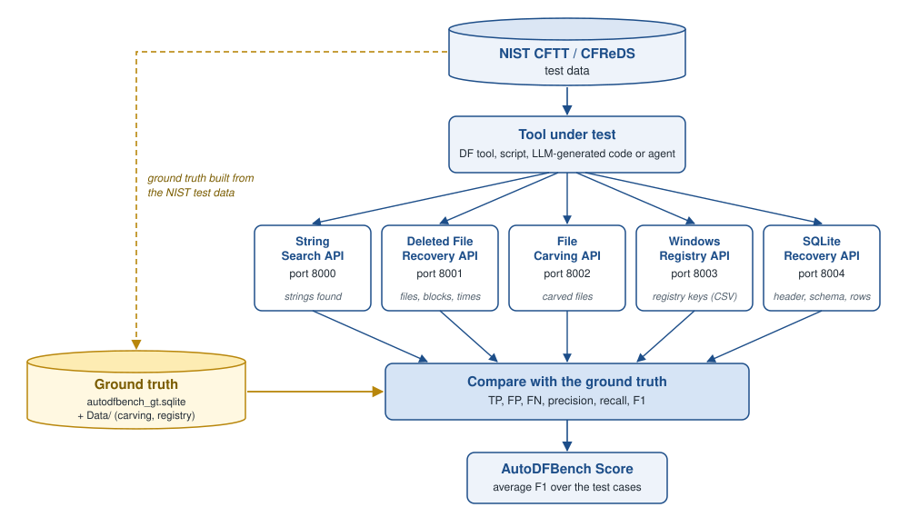

<p align="center">
  <a href="LICENSE"></a>
  <a href="https://dl.acm.org/doi/abs/10.1145/3712716.3712718"></a>
  <a href="https://arxiv.org/abs/2512.16965"></a>
</p>

<p align="center">
  
</p>

# AutoDFBench 1.1.1

**AutoDFBench** is an automated benchmarking framework for evaluating **digital forensic tools, scripts, and AI-generated code** against the **NIST Computer Forensics Tool Testing (CFTT) programme**.

The framework supports automated testing, validation, and benchmarking of forensic tools across multiple digital forensic tasks while generating standardised evaluation metrics including **precision, recall, F1 score, and AutoDFBench Score**.

AutoDFBench enables **reproducible and comparable benchmarking** for:

- Digital forensic tools
- DF scripts
- AI-generated forensic code
- Agent-based forensic systems

---

## Changes Since 1.1.1 (not yet released)

- **Windows registry:**
  - API fixes: `write_db` is honoured, each upload gets its own folder, and errors say what is wrong.
  - Ground-truth set 1.1 corrects MR-08 and NR-03-3. Set 1.0, used in the AutoDFBench 1.0 paper, stays the default (see the [registry API doc](docs/AutoDFBench_Windows_Registry_Evaluation_API.md)).
- **SQLite recovery:** SFT-04 ground truth and scorer; SFT-01 ground truth completed; SFT-03-WAL uses NIST's file names.

## What's New in 1.1.1

- **File carving scoring fixes:**
  - HEIC files can now be opened (`pillow-heif`), so the HEIC test cases can be scored.
  - Each ground-truth file is credited once; extra matches count as false positives.
  - Uploaded files with the same name no longer overwrite each other.
  - Comparison is about 12× faster.
  - Scores can differ from 1.1 for HEIC cases and for submissions with duplicates.
- **Windows registry API works again:** pandas was missing from the 1.1 image.
- **Settings:** none are required. The leftover MySQL settings were removed, and `.env.example` lists the optional ones (see [Configuration](#configuration-optional)).

## What's New in 1.1

- **One container, no database server.** The ground truth ships with the repository as a SQLite file (`ground_truth/autodfbench_gt.sqlite`). MySQL, phpMyAdmin and `.env` credentials are no longer needed. See [Quick Start](#quick-start).
- **Smaller image:** 235 MB (previously about 8 GB).
- **Run without Docker** with `pip install -r requirements-api.txt && python serve.py`.
- **Ground-truth corrections** for deleted file recovery: corrected `dfr_blocks` for 20 rows; `Grumium.txt` added to DFR-07/ntfs-07.
- **Scorer fix** for deleted files that share the same block set.

---

## Purpose

AutoDFBench evaluates **both conventional digital forensic tools and AI-generated forensic code** against NIST CFTT ground-truth test cases, producing standardised precision, recall, and F1 scores.

> **It is not a tool that performs forensic searches itself: it is a scoring and comparison framework.**

---

## How It Works

<p align="center">
  
</p>

1. The tool under test runs one of the AutoDFBench test cases (each one uses NIST CFTT / CFReDS test data).
2. Its output is sent to the API of that task (or scored in bulk with [`csv_eval.py`](#batch-evaluation-using-csv)).
3. The API compares the output with the ground truth and returns TP, FP, FN, precision, recall and F1 as JSON.
4. The AutoDFBench Score of a run is the average F1 over its test cases.

> **Note on LLMs:** LLMs are used as *code generators* or agents, not as direct search engines.
> The generated code is executed in an isolated environment; its output is then submitted to the API for scoring.

---

## Supported Digital Forensic Tasks

AutoDFBench covers the five areas of the NIST CFTT programme:

| Task | What the tool must do | NIST test data | Test case names (examples) |
|---|---|---|---|
| String Search | Find every occurrence of a string in a disk image: exact, ignore case, whole word, Boolean, Unicode, personal data, text in documents, fragments and file names | CFTT string search images (Windows and Linux) | `FT-SS-01`, `FT-SS-07-g1` |
| Deleted File Recovery | Recover deleted files: names, sizes, data blocks and MAC times | CFTT deleted file recovery images (FAT, NTFS, EXT) | `DFR-01/ntfs-01` |
| File Carving | Carve graphic files (JPEG, PNG, GIF, BMP, TIFF, HEIC) from images without a file system | CFReDS "File Carving Graphic Files" (2023) | `carv-frag-jpg` |
| Windows Registry Recovery | List the keys of a registry hive, including manipulated and corrupted hives | CFReDS Windows registry hives (2017) | `NR-02-1`, `MR-08`, `CR-02` |
| SQLite Data Recovery | Report the database header and schema, recover deleted and changed rows, and name their source file | CFTT SQLite Data Recovery (v1.0) | `SFT-01-UTF8-WAL`, `SFT-03-WAL` |

The AutoDFBench 1.0 paper describes **63 test cases and 10,968 unique test scenarios** derived from CFTT datasets.

---

## Documentation

### API Documentation

Detailed API documentation is available in the `docs/` folder:

| Task | Documentation |
|---|---|
| String Search | `docs/AutoDFBench_StringSearch_Evaluation_API.md` |
| File Carving | `docs/AutoDFBench_File_Carving_Evaluation_API.md` |
| Deleted File Recovery | `docs/AutoDFBench_Deleted_File_Recovery_Test_Cases.md` (test cases and API) |
| Windows Registry | `docs/AutoDFBench_Windows_Registry_Evaluation_API.md` |
| SQLite Recovery | `docs/AutoDFBench_SQLite_Recovery_Evaluation_API.md` |

### Ground Truth Data

Details about datasets and evaluation data: `docs/Data.md`

| Task | Ground truth | Ships with the repository |
|---|---|---|
| String Search, Deleted File Recovery, SQLite Recovery | `ground_truth/autodfbench_gt.sqlite` | Yes |
| File Carving | `ground_truth/autodfbench_gt.sqlite`, plus the original files in `Data/source` | Database only |
| Windows Registry | One CSV per test case in `Data/windows_registry` (set 1.0); corrected files of set 1.1 in `Data/windows_registry_v1.1` | No |

`ground_truth/autodfbench_gt.sqlite` (checksum in `ground_truth/autodfbench_gt.sqlite.sha256`) needs no database server. It is ground truth V3.2 (`docker/mysql/init/AutoDFBenchV3.2.sql`) with later corrections: 20 deleted-file-recovery `dfr_blocks` rows, the deleted file `Grumium.txt` in DFR-07/ntfs-07, and the SQLite SFT-01, SFT-03-WAL and SFT-04 changes listed above.

Evaluation results (`write_db: true`) are stored in `results/autodfbench_results.sqlite`. Set `AUTODFBENCH_GT_DB` / `AUTODFBENCH_RESULTS_DB` to use other paths.

Maintainers who edit the ground truth in MySQL can regenerate the SQLite file with `tools/build_gt_sqlite.py`. Registry ground-truth set 1.1 is built from the NIST hives with `tools/build_registry_gt.py`.


---

## Quick Start

### Docker (one container)

Requires Docker: Docker Desktop on Windows/macOS, or Docker Engine with the Compose plugin on Linux. Check with `docker --version` and `docker compose version`.

```bash
git clone https://github.com/akila-UCD/AutoDFBench.git
cd AutoDFBench
docker compose up -d
```

This pulls the prebuilt image `akila1989/autodfbench-api:1.1.1` from Docker Hub (about 106 MB). Use `docker compose up -d --build` to build it from the source instead.

### Without Docker

Requires Python 3.10–3.12.

```bash
git clone https://github.com/akila-UCD/AutoDFBench.git
cd AutoDFBench
pip install -r requirements-api.txt
python serve.py
```

Either way, the APIs listen on:

| Port | API | Endpoint |
|---|---|---|
| 8000 | String Search | `POST /api/v1/string-search/evaluate` |
| 8001 | Deleted File Recovery | `POST /api/v1/deleted_file_recovery/evaluate` |
| 8002 | File Carving | `POST /api/v1/file-carving/evaluate` |
| 8003 | Windows Registry | `POST /api/v1/windows-registry/evaluate` |
| 8004 | SQLite Recovery | `POST /api/v1/sqlite-recovery/evaluate` |

`python serve.py --base-port 9000` moves them to 9000–9004. A single API can still be started on its own, e.g. `API_PORT=8001 python -m API.deleted_file_recovery_api`.

File carving and Windows registry evaluation read their source files from `Data/`, which is not part of the repository. Docker mounts it into the container read-only.

### Check it is running

```bash
curl -s -X POST http://localhost:8000/api/v1/string-search/evaluate \
  -H "Content-Type: application/json" \
  -d '{"base_test_case":"FT-SS-01","file_contents_found":[""],"os":"windows","tool_used":"test","write_db":false}'
```

A JSON response with `total_gt_lines` means the API and the ground truth are working. With Docker, `docker compose logs autodfbench` lists the five APIs.

### Stop and update

```bash
docker compose down                                       # stop
git pull && docker compose pull && docker compose up -d   # update to a newer version
```

Results written with `write_db: true` stay in `results/autodfbench_results.sqlite`.

---

## Configuration (optional)

AutoDFBench needs **no `.env` file and no database credentials**: the MySQL settings used before 1.1 (`DB_HOST`, `DB_USER`, `DB_PASSWORD`, …) are no longer read. All settings have working defaults.

To change one:
- **Without Docker:** copy `.env.example` to `.env` in the repository root, then edit it.
- **With Docker:** add the variable under `environment:` in `docker-compose.yml`.

| Variable | Default | Purpose |
|---|---|---|
| `AUTODFBENCH_GT_DB` | `ground_truth/autodfbench_gt.sqlite` | Ground-truth database (read-only) |
| `AUTODFBENCH_RESULTS_DB` | `results/autodfbench_results.sqlite` | Results written when a request sets `write_db: true` |
| `AUTODFBENCH_BASE_PORT` | `8000` | `serve.py` starts the five APIs on this port and the next four |
| `CARVING_SOURCE_DIR` | `Data/source` | Original files for file carving: the `source` folder of the CFReDS "File Carving Graphic Files" (2023) data set |
| `MAIN_PATH` | repository root | Windows registry ground-truth CSVs are read from `<MAIN_PATH>/Data/windows_registry` |
| `TEMP_FILE_UPLOAD_PATH` | `/tmp` | Uploaded files are stored here while being scored |

`.env.example` also lists the file carving scoring parameters (`GT_SELECT_STRATEGY`, `PHASH_*`, `Q_SIM_*`).

---

## Troubleshooting

| Message | Cause and fix |
|---|---|
| `Ground-truth database not found` | `ground_truth/autodfbench_gt.sqlite` is missing or incomplete. Check the clone with `git status` and `cd ground_truth && sha256sum -c autodfbench_gt.sqlite.sha256` |
| `Invalid test case or no GT …` | The API is reachable, but the `base_test_case` does not exist for that task. See the test case names in `docs/` |
| `Ground-truth source files not found` (file carving) | Put the `source` folder of the CFReDS "File Carving Graphic Files" (2023) data set in `Data/source` |
| `Ground truth file not found` (Windows registry) | Put the registry ground-truth CSVs in `Data/windows_registry` |
| `Ground truth file not found: windows_registry_v1.1/...` | Build ground-truth set 1.1: `python tools/build_registry_gt.py --hives /path/to/win_REG` |
| Port already in use | Change the left-hand side of `ports` in `docker-compose.yml` (e.g. `"9000-9004:8000-8004"`), or run `python serve.py --base-port 9000` |

---

## Batch Evaluation Using CSV

`csv_eval.py` scores many tool outputs at once without the API. Each CSV row is one submission, and `--include-summary` adds the AutoDFBench suite score (mean F1).

```bash
python3 csv_eval.py <test_suite> <batch_label> <input.csv> <output.csv> --include-summary
```

Run it from the repository root after `pip install -r requirements-api.txt`. Ready-to-run examples:

```bash
python3 csv_eval.py string_search EXAMPLE examples/string_search.csv out/ss_results.csv --include-summary
python3 csv_eval.py deleted_file_recovery EXAMPLE examples/deleted_file_recovery.csv out/dfr_results.csv --include-summary
python3 csv_eval.py sqlite_recovery EXAMPLE tests/sqlite_recovery_test.csv out/sqlite_results.csv --include-summary
```

Input columns per test suite (JSON columns hold a JSON list or object):

| `test_suite` | Columns |
|---|---|
| `string_search` | `base_test_case`, `tool_used`, `os`, `file_contents_found` (JSON list of lines found) |
| `deleted_file_recovery` (or `dfr`) | `base_test_case`, `tool_used`, `file_system`, `test_set`, `sector_size`, `check_meta`, `files_json` (JSON list of `{file_name, file_size, blocks}`) |
| `file_carving` | `base_test_case`, `tool_used`, `files_json` (JSON list of carved file paths) |
| `windows_registry` (or `wr`) | `base_test_case`, `tool_used`, `submitted_csv_path`, `job_id`, optional `gt_set` (`1.0` default, or `1.1`) |
| `sqlite_recovery` (or `sqlite`) | `base_test_case`, `tool_used`, `task_id`, `file_name`, `sqlite_table_name`, `extracted_data_json` |

File carving and Windows registry also need their source data in `Data/`.

---

## AutoDFBench Score

The evaluation results include:

| Metric | Description |
|---|---|
| True Positives | Correctly identified forensic artefacts |
| False Positives | Incorrectly identified artefacts |
| False Negatives | Missed artefacts |
| Precision | TP / (TP + FP) |
| Recall | TP / (TP + FN) |
| F1 Score | Harmonic mean of Precision and Recall |
| **AutoDFBench Score** | **Average F1 across all executed test cases** |

The **AutoDFBench Score** is calculated as the average of the F1 scores across all executed test cases. This allows fair comparison between forensic tools, scripts, and AI-generated solutions.

---

## Citation

If you use AutoDFBench in academic work, please cite the following publications.

---

## Publications

### AutoDFBench (DFDS 2025)

Akila Wickramasekara, Alanna Densmore, Frank Breitinger, Hudan Studiawan, and Mark Scanlon.  
**AutoDFBench: A Framework for AI Generated Digital Forensic Code and Tool Testing and Evaluation.**  
Digital Forensics Doctoral Symposium (DFDS), 2025.

Paper: [https://dl.acm.org/doi/abs/10.1145/3712716.3712718](https://dl.acm.org/doi/abs/10.1145/3712716.3712718)

```bibtex
@inproceedings{wickramasekara2025AutoDFBench,
  author    = {Wickramasekara, Akila and Densmore, Alanna and Breitinger, Frank and Studiawan, Hudan and Scanlon, Mark},
  title     = {AutoDFBench: A Framework for AI Generated Digital Forensic Code and Tool Testing and Evaluation},
  booktitle = {Digital Forensics Doctoral Symposium},
  series    = {DFDS 2025},
  year      = {2025},
  month     = {04},
  publisher = {Association for Computing Machinery},
  doi       = {10.1145/3712716.3712718}
}
```

### AutoDFBench 1.0

Akila Wickramasekara, Tharusha Mihiranga, Aruna Withanage, Buddhima Weerasinghe, Frank Breitinger, John Sheppard, and Mark Scanlon.  
**AutoDFBench 1.0: A Benchmarking Framework for Digital Forensic Tool Testing and Generated Code Evaluation.**

Paper: [https://arxiv.org/abs/2512.16965](https://arxiv.org/abs/2512.16965)

```bibtex
@article{Wickramasekara2026AutoDFBench1.0,
  title   = {AutoDFBench 1.0: A Benchmarking Framework for Digital Forensic Tool Testing and Generated Code Evaluation},
  journal = {Forensic Science International: Digital Investigation},
  volume  = {56S},
  month   = {03},
  year    = {2026},
  issn    = {2666-2817},
  author  = {Akila Wickramasekara and Tharusha Mihiranga and Aruna Withanage and Buddhima Weerasinghe and Frank Breitinger and John Sheppard and Mark Scanlon},
  keywords = {Digital Forensics, Tool Testing and Validation, Generated Code Validation, Benchmark, NIST Computer Forensics Tool Testing Program (CFTT)},
  abstract = {The National Institute of Standards and Technology (NIST) Computer Forensic Tool Testing (CFTT) programme has become the de facto standard for providing digital forensic tool testing and validation. However to date, no comprehensive framework exists to automate benchmarking across the diverse forensic tasks included in the programme. This gap results in inconsistent validation, challenges in comparing tools, and limited validation reproducibility. This paper introduces AutoDFBench 1.0, a modular benchmarking framework that supports the evaluation of both conventional DF tools and scripts, as well as AI-generated code and agentic approaches. The framework integrates five areas defined by the CFTT programme: string search, deleted file recovery, file carving, Windows registry recovery, and SQLite data recovery. AutoDFBench 1.0 includes ground truth data comprising of 63 test cases and 10,968 unique test scenarios, and execute evaluations through a RESTful API that produces structured JSON outputs with standardised metrics, including precision, recall, and F1 score for each test case, and the average of these F1 scores becomes the AutoDFBench Score. The benchmarking framework is validated against CFTT datasets. The framework enables fair and reproducible comparison across tools and forensic scripts, establishing the first unified, automated, and extensible benchmarking framework for digital forensic tool testing and validation. AutoDFBench 1.0 supports tool vendors, researchers, practitioners, and standardisation bodies by facilitating transparent, reproducible, and comparable assessments of DF technologies.}
}
```

---

## License

AutoDFBench is released as open-source software under the **Apache License 2.0**.

The framework is publicly available via the GitHub repository:
[https://github.com/akila-UCD/AutoDFBench](https://github.com/akila-UCD/AutoDFBench)

The Apache 2.0 license permits use, modification, and distribution of the software while requiring preservation of the copyright notice and license terms.

See the [LICENSE](LICENSE) file for the full license text.
